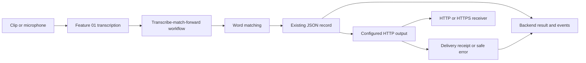

# Transcript Matching and Forwarding

## Purpose

Compose the existing Feature 01 transcription interface with literal keyword/phrase matching and workflow-owned output delivery. Feature 01 continues to own audio input, model execution, chunking, transcript events, and session lifecycle. The matching feature finds configured terms in transcript text. The workflow emits cumulative match snapshots to its backend caller; MQTT microphone output contains chunk-local transcript and match results, while HTTP clip output retains its terminal completed-transcript behavior; live HTTP and MQTT output is sent per chunk. MQTT does not publish audio-file clip results.

## Matching contract

- `WordMatchingConfig` contains a non-empty list of unique target keywords or phrases and a selected `language` of `th`, `en`, or `auto` (default `th`). `auto` selects automatic language detection; it does not represent a detected language. Recognition of code-switched speech depends on the selected model.
- `match_keywords(text, config)` returns a `WordMatchResult` containing the language and one `{keyword, count}` result per configured target, including targets with zero occurrences.
- Normalize source text and each configured target to Unicode NFC, then case-fold them before comparison.
- `StreamingWordMatcher(config).add_chunk(text)` returns the same cumulative `WordMatchResult` as matching chunks joined by a single space, consuming chunks in delivery order. It retains only counters and at most the longest normalized target length minus one text characters. Feature 01 live sources deliver each source's chunks in order; arbitrary reordered transcript histories are not assembled.
- Match literal substrings. Whitespace and punctuation are ordinary characters and only match when present in both source and target. Count overlapping occurrences for each target independently; different targets may match overlapping spans.
- All three language selections use the same NFC-normalized, case-folded literal-substring matching algorithm. Raise `WordMatchingError` for unsupported languages or invalid targets. Matching does not require a tokenizer dependency or add language detection.

## Pipeline behavior

- `transcribe_clip_and_forward(clip, model_handle, forwarder, matching_config, flow_config=None)` invokes Feature 01 clip transcription and matches the complete transcript. It forwards one result for HTTP/callable senders; with an MQTT sender it suppresses publication and returns null receipt/error. It returns a `PipelineResult` containing transcript, per-keyword counts, source ID, delivery result, and `latest_rtf`. `latest_rtf` is the RTF from the most recent chunk measurement, or null when no chunk produced a measurement. An optional measurement callback receives each Feature 01 clip measurement as it arrives.
- `forward_session(session, forwarder, matching_config)` consumes a Feature 01 session result queue and emits an absolute cumulative `match_results` snapshot after each transcript event, including zero-count targets. It maintains cumulative counts and only the text suffix required for cross-chunk matching, without retaining the full transcript. Snapshots replace earlier counts; consumers must not add snapshots together. It returns a wrapper exposing the source ID, output event queue, and idempotent `stop()` that delegates to Feature 01 and waits for matching and delivery.
- The session workflow can wrap a `TranscriptionSession` or `ProcessSession`; callers wrap each source from a process group independently.
- Session output exposes each original transcript event immediately followed by its cumulative `match_results` snapshot. HTTP, callable, and MQTT destinations send one record for each transcript event; each record contains only that chunk's transcript and match counts, with a forwarding result/error after each attempt. They do not send an aggregate record at terminal completion; stopping flushes and sends the last transcript chunk through the normal chunk event. Forwarding failures do not erase cumulative match counts or stop later chunk processing.
- Live sessions send no terminal aggregate record, including on failure. Previously delivered chunk records remain distinct; workflow lifecycle and delivery errors are available through backend status/events.

Operational decision (2026-10-17): HTTP and MQTT are real-time destinations for live microphone/RTSP workflows. Both send chunk-local results with unique event IDs and bounded retries; a failed chunk is dropped after retry exhaustion so later chunks can continue. No live transcript history is retained for terminal delivery. Durable delivery, an outbox, and replay are not required for this use case. Backend recovery is defined by the [microphone recovery contract](../backend-transcription-api/spec.md#microphone-recovery).

### Speech gate settings and timing

Callable clip/live workflows pass normalized VAD and adjustable RMS settings to model deployment; the [Feature 01 contract](../new-speech-to-text/spec.md#voice-activity-detection) owns their behavior. Gate settings are copied into run configuration and retained through capture recovery. VAD-only skip measurements are forwarded without producing transcript/keyword events. `latest_rtf` reflects the latest measured chunk, including a VAD-only skip; no measurements means null. Per-chunk events retain these real costs; the [backend API contract](../backend-transcription-api/spec.md#get-transcriptionsworkflow_id) defines their exclusion from run minimum/average/maximum RTF and count while preserving latest RTF.

### OpenVINO decoder configuration

The existing workflow `flow_config.decoding_options` carries the [OpenVINO speech filter](../new-speech-to-text/spec.md#openvino-speech-filtering). Normalize through the public model-deployment helper and deep-copy the nested settings at workflow admission. Preserve the snapshot for shared/isolated clips, microphone/RTSP starts, and recovery. A decoder-filtered empty result produces no live transcript/keyword forwarding event; its processing measurement still contributes to RTF. The [backend settings contract](../backend-transcription-api/spec.md#openvino-speech-filter-settings) owns persistence and transport.

## Forwarding contract

The HTTP forwarder accepts a required HTTP(S) endpoint URL, optional bearer token, timeout, and retry settings through a configuration object. Defaults are a 5-second request timeout and 3 total attempts. Retry network failures, HTTP 429, and HTTP 5xx responses with bounded backoff; report other non-2xx responses as `ForwardingError` without retrying. No persistent queue is included; after retries are exhausted, return the failure to the caller.

Send one JSON record per completed clip or live transcript chunk:

```json
{
  "event_type": "transcription.match_results",
  "event_id": "<source_id>",
  "source_id": "<source_id>",
  "language": "th",
  "transcript": "<complete transcript>",
  "matches": [
    {"keyword": "สวัสดี", "count": 2},
    {"keyword": "ลาก่อน", "count": 0}
  ],
  "status": "completed",
  "completed_at": "<UTC ISO 8601 timestamp>"
}
```

For clips, `status` is `completed`, `event_id` is the source ID, and `transcript` and `matches` cover the complete clip. For live microphone/RTSP sources, `status` is `completed` for each recognized chunk, `event_id` is `<source_id>:chunk:<n>` with a monotonically increasing counter starting at 1, and `transcript` and `matches` cover only that chunk. Live records also include nullable `rtf`. Include every configured target in `matches`, including zero-count entries. Send `Idempotency-Key: <event_id>` and, when configured, `Authorization: Bearer <token>`. Treat any 2xx response as delivered; the response body is not part of the contract.

## Usage

Install the project, then compose the callable modules from the host application:

```python
import os

from speech_to_text.features.model_deployment import load_model, start_microphone_flow
from speech_to_text.features.word_matching import WordMatchingConfig
from speech_to_text.workflows.transcribe_match_forward import (
    HttpForwarder,
    HttpForwarderConfig,
    forward_session,
)

model = load_model({"model": "turbo", "runtime": "openvino-gpu"})
forwarder = HttpForwarder(HttpForwarderConfig(
    endpoint_url=os.environ["TRANSCRIPT_WEBHOOK_URL"],
    bearer_token=os.environ.get("TRANSCRIPT_WEBHOOK_TOKEN"),
))
matching = WordMatchingConfig(keywords=("สวัสดี", "ลาก่อน"))
session = start_microphone_flow(None, model, {"language": "th"})
workflow = forward_session(session, forwarder, matching)

# The workflow exposes transcript, match_results, forwarding, and completion events.
workflow.stop()
model.close()
```

For a finite WAV, use `transcribe_clip_and_forward(clip, model, forwarder, matching, flow_config)` from the same workflow module. `forward_session` can also wrap each session returned by Feature 01's process-group API.

`list_available_microphones()` delegates device discovery to Feature 01's public callable so backend routes can preserve the workflow boundary.

## Module layout

- `speech_to_text/features/word_matching/` exposes keyword/phrase matching and hides its normalization and substring-search implementation.
- `speech_to_text/workflows/transcribe_match_forward/` composes Feature 01 and matching, returns results to its caller, and owns configured HTTP clip/session and HTTP/MQTT session output delivery. Its `http_output.py` module implements the optional outbound HTTP destination.

The public `TranscriptionService` facade owns lazy model handles for shared backend operations. It reads `SPEECH_TO_TEXT_MODEL`, `SPEECH_TO_TEXT_RUNTIME`, and `SPEECH_TO_TEXT_PRECISION` when no explicit model configuration is supplied, then exposes keyword validation, clip transcription, microphone startup, device listing, and `close()`. The clip API's `execution_mode` and process lifecycle contract are defined by the [backend lifecycle](../backend-transcription-api/spec.md#lifecycle-and-limits). The facade translates Feature 01 and matching errors into workflow-owned configuration, input, and dependency errors for backend callers.

HTTP failures raise `ForwardingError` with status and safe diagnostic context.

## Original callable scope limits

- Match configured literal substrings cumulatively across live chunks and across the complete transcript for finite clips.
- HTTP destinations forward completed clips once. HTTP/callable and MQTT destinations forward live microphone chunks separately, without a terminal aggregate record; clip transcription produces no MQTT publication.
- The original callable delivery implementation includes no UI page, inbound HTTP route, database, durable outbox, or destination-specific payload mapping. MQTT microphone records contain chunk-local text and matches; workflow events preserve each source transcript event and cumulative match snapshots. Live run event retention and display behavior follow the [backend monitoring contract](../backend-transcription-api/spec.md#get-transcriptionsworkflow_id). Configurable destination extensions are described below.

## Acceptance criteria

- Matching is callable independently and supports the documented Thai configuration, normalization, literal-substring, and occurrence-count behavior.
- Clip orchestration invokes Feature 01 once, matches the assembled transcript, forwards one record with a stable source ID, and returns the result.
- Session orchestration preserves Feature 01 event order and emits cumulative matching snapshots after each transcript chunk. It sends chunk-local records after each transcript event for HTTP, callable, and MQTT destinations, without an additional terminal record, for local and process sessions.
- HTTP forwarding sends the documented JSON and headers, honors timeout/retry settings, and reports permanent and exhausted transient failures explicitly.
- The implementation stays in the module layout above and does not alter Feature 01's transcript/event contract.

## References

- [Feature 01 contract](../new-speech-to-text/spec.md)

## Configurable JSON output

Planning date: 2026-10-14. Implementation extends the existing callable contract with saved destination selection. The original design below also includes later-stage work; the current interface and remaining scope are distinguished here.

### Current destination interface

`DestinationConfig`, `AuthConfig`, `DestinationRegistry`, `build_forwarder`, and `destination_summary` are exported from the workflow package. `destinations.py` validates configuration and resolves deployment-managed secret/resource references; `http_output.py` owns HTTP delivery and `mqtt_output.py` owns MQTT delivery. The packaged `match_results_v1.schema.json` describes the unchanged completed-source body.

Saved destination configurations support `POST|PUT|PATCH`, non-secret custom headers, `none|bearer|basic|api_key_header` authentication, the timeout/backoff/Retry-After settings in the design table, and a configurable idempotency header. `basic` uses `username_secret_ref` and `password_secret_ref`; bearer/API key use `secret_ref`, with `header_name` additionally required for API keys. Reject unused or conflicting authentication settings. Credentials require HTTPS. Secret values are resolved from environment variables listed in `SPEECH_TO_TEXT_DESTINATION_SECRET_REFS`; the saved configuration contains only their names.

The implemented TLS fields are flat names: `tls_ca_bundle_ref`, `tls_client_certificate_ref`, and `tls_client_key_ref`. Each names an environment variable containing an absolute resource path; approved names are listed in `SPEECH_TO_TEXT_DESTINATION_RESOURCE_REFS`. Validate and load trust/client material before accepting a workflow, keeping hostname and certificate checks enabled. Certificate/key references must be supplied together.

A locally saved registry entry approves its origin. `SPEECH_TO_TEXT_DESTINATION_ALLOWED_ORIGINS` can additionally supply comma-separated deployment-approved origins. Public addresses are allowed for approved origins. Private/loopback destinations also require an IPv4/IPv6 CIDR in `SPEECH_TO_TEXT_DESTINATION_ALLOWED_NETWORKS`; an empty value approves none. The UBX-330M installer's generated Compose file sets this variable to `0.0.0.0/0,::/0`, approving private/loopback destinations on any network. Link-local and known metadata addresses remain blocked, including IPv4-mapped IPv6 equivalents. Resolve and validate all DNS answers before connecting directly to an approved address while retaining the original TLS hostname. Registry-built senders ignore environment proxy settings and do not follow redirects.

Legacy Python `HttpForwarderConfig(endpoint_url, bearer_token)` callers without an explicit `egress_policy` retain their original urllib transport behavior. Backend-selected destinations always use registry-built senders with enforced egress policy. This distinction preserves the original callable integration while protecting destinations configured through the API.

Payload mapping, proxy configuration, `{event_id}` URL substitution, a durable outbox, and cross-process registry refresh are not implemented. Only `match_results_v1` and literal endpoint URLs are accepted. HTTP live delivery follows the per-chunk [forwarding contract](#forwarding-contract); MQTT details are defined in the [MQTT destination contract](#mqtt-destination-contract). Delivery remains in memory; saved destination definitions survive restart, pending delivery does not. Concrete inbound routes and profile fields are owned by the [backend API contract](../backend-transcription-api/spec.md#output-destination-selection).

### MQTT destination contract

Implemented 2026-10-15. `protocol` defaults to `http`, preserving existing stored destination definitions; `protocol: "mqtt"` selects MQTT 3.1.1 TCP publication through the optional `mqtt` extra (Paho 2.x). `endpoint_url` accepts only `mqtt://host[:port]` or `mqtts://host[:port]`, default ports 1883/8883. URL credentials, paths beyond `/`, queries, and fragments are rejected. No WebSocket or MQTT 5 mode is advertised.

MQTT requires `mqtt_topic` (nonempty UTF-8, at most 65535 bytes, no NUL or subscription wildcards), accepts strict `mqtt_qos` 0/1/2 (default 1), and `mqtt_retain` (default false). Authentication is `none` or `username_password`, using approved `username_secret_ref`/`password_secret_ref` values together. Credentials require `mqtts://`; common CA and mutual TLS reference fields apply. The same private-network approval and DNS pinning policy applies. HTTP methods, headers, redirects, Retry-After, and HTTP idempotency headers have no MQTT controls.

`MqttForwarderConfig`, `MqttForwarder`, and `MqttForwardingReceipt` implement the same `forward(record)` boundary for microphone workflows. Shared and process-isolated microphones publish one record for each transcript chunk. Each microphone record's `transcript` and `matches` describe only that chunk, so phrases that span chunk boundaries appear in cumulative workflow/UI results but not in any one MQTT chunk record. No aggregate is published on completion; a final partial chunk flushed by stop is published through its transcript event, and a session without transcript events publishes no MQTT record. Finite clip transcription with an MQTT destination selected still returns transcript, matches, and RTF to the application but does not publish a record. Microphone chunk records retain the `match_results_v1` fields: `source_id` is the stable session ID, `event_id` is `<source_id>:chunk:<1-based transcript ordinal>`, and `status` is `completed`. MQTT chunk records add optional nullable numeric `rtf` from the Feature 01 measurement with the same sequence. It is null if no measurement is available. The RTF meaning and calculation are defined by the [Feature 01 measurement contract](../new-speech-to-text/spec.md#per-chunk-performance-measurement). Bounded retries use identical bytes and a stable event ID. Receivers should deduplicate that ID because reconnect/retry can repeat a publication even with QoS 2.

Saving an MQTT destination with `mqtt_retain: false` publishes an empty retained packet to that saved topic after the settings persist. This removes any retained packet on that exact topic; connected subscribers may receive the empty payload. The save response reports `retained_cleanup` status, attempts, and a safe error code when clearing fails. The settings remain saved on failure, and saving again retries cleanup. Retain-enabled and HTTP saves do not publish a cleanup packet; loading or testing settings does not clear retained data. Active workflows keep their start-time sender snapshot.

QoS 0 success records completion of the local send; QoS 1/2 wait for broker publication acknowledgement within the attempt timeout. Success does not prove subscriber processing. TLS validation or permanent connection rejection fails without retry; network failures and missing acknowledgements retry up to the configured limit. Delivery receipts expose `transport: "mqtt"`, topic/QoS, attempts, and nullable HTTP status (null). Delivery remains non-durable in memory.

Real broker tests cover QoS 0/1/2, synthetic API delivery, suppressed MQTT clip output, chunk-local shared/process-isolated microphone output, and saved frontend settings. The [full test command](../../docs/contributing.md#tests-and-validation) provisions an isolated broker. The [deployment guide](../../docs/deployment.md#mqtt-broker) owns broker startup, health checks, and persistence instructions.

### Frontend configuration

The `/destinations` page is linked from the EchoDesk workspace navigation. It lists safe saved receiver summaries and lets callers create, read, replace, and delete settings using the [destination endpoints](../backend-transcription-api/spec.md#destination-endpoints). The form covers the implemented destination fields above, shows the canonical outgoing JSON preview, and stores only secret/resource reference names. It explains that saving with MQTT retain off clears the retained packet on the configured topic, and reports cleanup failure separately from the successful settings save. Unsupported proxy, mapping, and redirect behavior have no enabled controls.

The live test action explicitly sends synthetic JSON using saved settings. Unsaved field or header edits disable it until saved. The page distinguishes saved configuration from successful receiver acceptance and shows test failures independently. A destination used by a profile cannot be deleted; the error links back to profiles. Loading, API connection, validation, and API errors provide a retry or corrective action.

Profile create/edit/duplicate includes optional destination selection. An unavailable saved ID is shown explicitly and can be replaced or cleared. Run Detail reports delivery independently from transcript status, with attempts, HTTP status, and safe failure codes. Layout supports narrow screens with visible destination navigation and keyboard focus. Browser receiver fixtures verify synthetic delivery without requiring a physical microphone or a real inference model.

### Goal and compatibility

Allow clip and microphone workflows, including profile-started runs in both execution modes, to send JSON to a configured HTTP or HTTPS receiver. Receiver technology is irrelevant: a compatible endpoint may be served by FastAPI, Express, PHP, Java, .NET, a reverse proxy, or an API gateway. HTTP compatibility alone does not make application schemas or authentication interchangeable; each destination must accept the configured method, body, and credentials.

Keep one optional destination per run. HTTP sends one logical output record per completed clip. HTTP and MQTT live sessions send one chunk-local record per transcript event with a unique chunk event ID, and no terminal aggregate. Workflow events expose source transcript events and cumulative match snapshots; backend live monitoring retains chunk text and exposes cumulative match totals as specified by the [backend monitoring contract](../backend-transcription-api/spec.md#get-transcriptionsworkflow_id). Keep Feature 01 unchanged. Preserve existing Python callers using `endpoint_url` and `bearer_token`, and preserve the current JSON fields without renaming or wrapping them. No destination means no network request and no synthetic delivery event.



### JSON contract

Use the existing record in [Forwarding contract](#forwarding-contract) as the default payload. Preserve Thai strings and encode the body as UTF-8. Send `Content-Type: application/json`; JSON requires no `charset` media-type parameter. Reject non-finite numbers and validate the complete body before sending. Publish a JSON Schema for this existing shape during implementation, with required fields, string types, non-negative integer match counts, UTC completion time, and `completed|stopped|failed` status values. Track its initial version as `match_results_v1` in destination configuration rather than adding a required field to existing receiver payloads.

Serialize once per clip or live chunk and reuse identical bytes, completion time, and event ID on retries. Delivery state belongs in the backend result, not in the outgoing transcription `status`. A network failure must preserve the transcript and matches. Clip failures before a transcript result exists do not generate a fabricated transcript record. Live failures do not send a terminal transcript record.

### Destination configuration

Use a deployment-managed registry keyed by `destination_id`. Profiles and direct API requests select an approved ID, rather than supplying arbitrary URLs, filesystem paths, or credentials. The registry is injected into the workflow service by backend composition. It is not a new inbound resource API or a separate integration feature. The workflow owns validation, serialization, and sending.

The following settings are proposed; they are not currently accepted by `HttpForwarderConfig`:

| Setting | Default | Contract |
| --- | --- | --- |
| `destination_id` | Required registry key | Stable name selected by a profile or API request. |
| `endpoint_url` | Required | Absolute `http://` or `https://` URL; domain, IPv4/IPv6, optional port, path, and non-secret query parameters. Reject userinfo, fragments, invalid ports, and control characters. |
| `method` | `POST` | Support `POST`, `PUT`, and `PATCH` for JSON delivery. GET/HEAD/DELETE/CONNECT/TRACE are outside this output contract. For PUT/PATCH, the caller supplies the intended resource URL; an optional `{event_id}` path placeholder is percent-encoded before use. |
| `headers` | `{}` | Non-secret custom headers; validate names/values and reject CR/LF. Transport controls Content-Type, Host, Content-Length, connection/framing fields, and the configured idempotency header. |
| `auth` | `none` | `none`, `bearer`, `basic`, or `api_key_header`; credential values are resolved from deployment-approved secret references. Custom authentication headers also use secret references. Reject conflicting Authorization settings. |
| `timeout_seconds` | `5.0` | Existing positive finite per-attempt timeout; retain its documented transport semantics rather than promising an overall wall-clock deadline. |
| `max_attempts` | `3` | Total attempts including the first; integer at least 1. |
| `backoff_seconds` / `max_backoff_seconds` | `0.25` / `2.0` | Existing bounded exponential backoff when Retry-After is absent or invalid. |
| `max_retry_after_seconds` | `30.0` | Parse Retry-After seconds and HTTP-date. If the requested delay exceeds this budget, stop with an explicit deferred/exhausted outcome rather than retrying early. |
| `follow_redirects` | `false` | Fail explicitly on 3xx; configure the receiver's final URL. |
| `tls.ca_bundle_ref` | System trust store | Deployment-approved CA bundle for private/self-signed PKI; certificate and hostname verification remain enabled. |
| `tls.client_certificate_ref` / `tls.client_key_ref` | `null` | Paired deployment-managed client certificate/key for mutual TLS. |
| `proxy_ref` | `null` | Optional deployment-managed HTTP proxy, including HTTPS CONNECT; proxy credentials remain secret. Do not silently inherit an uncontrolled proxy environment. |
| `payload_format` | `match_results_v1` | Existing body initially; destination-specific JSON mapping is a later delivery stage. |
| `idempotency_header` | `Idempotency-Key` | Valid header name or null when the receiver does not support it; value is the stable event ID. |

Example registry entry, with illustrative secret references:

```json
{
  "destination_id": "operations",
  "endpoint_url": "https://receiver.example.com:8443/api/transcripts",
  "method": "POST",
  "headers": {"X-Station": "ubx-330m"},
  "auth": {"type": "bearer", "secret_ref": "TRANSCRIPT_RECEIVER_TOKEN"},
  "timeout_seconds": 5.0,
  "max_attempts": 3,
  "payload_format": "match_results_v1"
}
```

Resolve and validate a destination before accepting a workflow. Copy its non-secret settings into a start-time snapshot and bind the resolved credential material privately for that run. Registry/profile edits affect later runs only. Do not expose secrets in profile responses, run snapshots, errors, URLs, or logs. Existing database rows gain a nullable destination ID without losing profile data. Invalid or unknown IDs return HTTP 422; unavailable secret/CA/proxy configuration returns a safe HTTP 503 before audio starts.

The current inbound API has no authentication; its destination endpoint access rules are maintained in the [backend API specification](../backend-transcription-api/spec.md#destination-endpoints). Keep egress restricted to explicitly approved origins and networks, including explicitly approved LAN receivers when needed. Validate DNS results at connection time and enforce policy for IPv4 and IPv6; reject metadata endpoints and unapproved loopback/link-local/private addresses. Plain HTTP is supported for explicitly approved, credential-free receivers. Bearer and other credential-bearing destinations require HTTPS. A destination test uses synthetic data, reports that it performs a real request, and uses the same egress/auth/TLS validation as normal forwarding.

### Delivery results and failure policy

- Treat HTTP 2xx as accepted by the receiver. HTTP 202 acknowledges acceptance, not downstream completion; do not require a response JSON body. Disable redirects and bound/discard response content.
- Keep bounded retries for connection failures, timeouts, HTTP 429, and HTTP 5xx. Classify invalid credentials, TLS trust/hostname failures, configuration errors, and other 4xx as permanent. Honor bounded Retry-After as described above.
- Retrying POST/PATCH after a lost response can repeat receiver side effects. The idempotency header is an application agreement, not an exactly-once guarantee. Receivers must implement deduplication for safe replay. PUT must address the correct resource. Keep event IDs stable for each source and attempt.
- Expose delivery separately from transcription: `disabled|pending|delivered|failed`, destination ID, event/source ID, attempts, nullable HTTP status, last-attempt UTC timestamp, and a sanitized error code. Reuse the existing workflow forwarding events and receipts where possible; do not fail successful transcription merely because output delivery failed.
- Sending and sleeping run in existing workflow workers, never the FastAPI event loop or inference/capture callbacks. Include the retry budget in stop/shutdown handling; release model/process resources even when delivery fails. Terminal completion may wait for bounded delivery, consistent with the current session contract.
- Retain in-memory delivery only. Restart may lose pending/failed output and run history. A durable outbox and operator replay are separately scoped work if restart-safe delivery is required.

### Implementation sequence and acceptance gates

1. **Workflow output contract:** extend the existing forwarder/configuration and publish the payload schema. Verify UTF-8 Thai round-trip, identical retry bodies, POST/PUT/PATCH, custom headers/auth, safe URL validation, redirects, 2xx/202/204, 4xx, 429/5xx, Retry-After, and timeout behavior against local test receivers.
2. **Backend and profiles:** inject the approved destination registry; pass the selected forwarder into clips, shared microphone sessions, and process-isolated sessions. Add optional `destination_id` to profile and microphone JSON requests and to clip multipart form fields. Preserve default no-forwarder behavior, migrate saved profiles without data loss, and expose delivery outcome through existing status/events. Verify snapshot behavior and model/process cleanup under delivery failure. The inbound contract is owned by the [backend API specification](../backend-transcription-api/spec.md#output-destination-selection).
3. **Profile UI:** add an optional destination selector showing approved IDs and safe destination summaries, output preview, and synthetic delivery test. Show delivery state independently on Run Detail. Verify save/duplicate/start/stop and failed delivery without exposing credentials. Use the existing profile and run pages.
4. **Receiver compatibility:** add private CA, mutual TLS, proxy support, and declarative JSON mapping for receivers needing a different field layout. Mapping supports nested object/array construction from canonical fields and static JSON values, preserves value types, and fails validation for missing source fields. No executable templates. Test each mode against controlled receivers before claiming support; update the payload-format table with the concrete mapping contract when this stage is specified.

Assign implementation of each documented feature to its own feature-development sub-agent under AGENTS.md; the parent reviews the contract and integration. Unimplemented later-stage capabilities remain out of the current release. A release is ready only when its advertised destination modes pass receiver tests and the frontend-to-workflow path sends a real chunk JSON result for live sessions or a terminal result for clips. Later stages must remain visibly unavailable until implemented and verified.

### Standards references

- [RFC 8259](https://www.rfc-editor.org/rfc/rfc8259.html): JSON encoding and application/json registration.
- [RFC 9110](https://www.rfc-editor.org/rfc/rfc9110.html): HTTP methods, status semantics, fields, HTTPS, and Retry-After.
- [RFC 6750](https://www.rfc-editor.org/rfc/rfc6750.html): bearer Authorization and TLS requirements.
